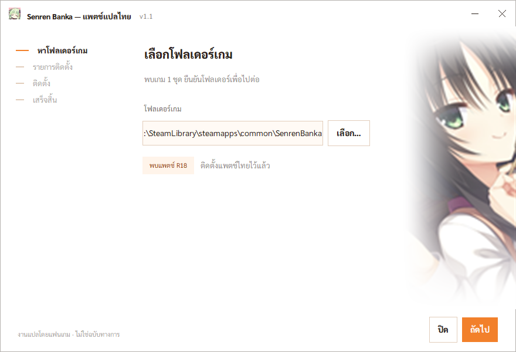
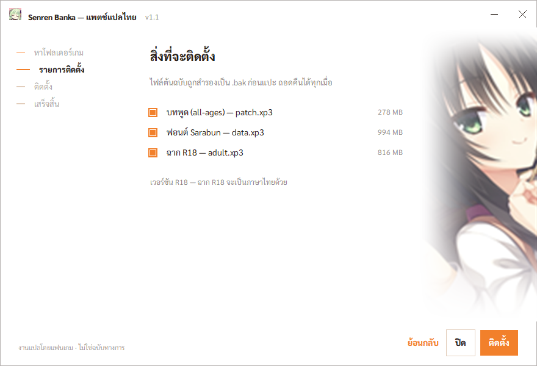

<h1 align="center">Senren Banka — แปลไทย</h1>

<p align="center">
  แพตช์แปลภาษาไทยสำหรับวิชวลโนเวล <b>千恋＊万花 (Senren Banka)</b> ของ Yuzusoft<br>
  แปลครบทั้งเกม ทุกเส้นทาง · ติดตั้งด้วยการดับเบิลคลิก · ถอดคืนได้ตลอด
</p>

<p align="center">
  
  
  
  
</p>

<p align="center">
  <a href="../../releases/latest"><b>⬇️ ดาวน์โหลดแพตช์ล่าสุด</b></a>
</p>

<p align="center">
  
</p>

---

## ติดตั้งใน 3 ขั้น

| | |
|:--:|---|
| **1** | โหลด `senrenbanka-thai-patch-v1.2.zip` จากหน้า [Releases](../../releases/latest) แล้วแตกไฟล์ไว้ที่ไหนก็ได้ — **ไม่ต้อง**แตกทับโฟลเดอร์เกม |
| **2** | ดับเบิลคลิก `SenrenBanka-Thai-Patch.exe` แล้วกดถัดไป มันหาโฟลเดอร์เกมให้เอง |
| **3** | เปิดเกม → **Config** → **Language** → เลือก **Chinese (Simplified)** → ได้ภาษาไทยทันที |

<p align="center">
  
  
</p>

> ไม่อยากใช้ตัวติดตั้ง? ในซิปมี `install.bat` / `uninstall.bat` ให้ด้วย
> ผลลัพธ์เหมือนกันทุกอย่าง แค่ต้องเอาไฟล์ไปวางในโฟลเดอร์เกมเองก่อน

---

## แปลไปถึงไหนแล้ว

| | ความคืบหน้า | รายละเอียด |
|---|---|---|
| **เนื้อเรื่องหลัก** (all-ages) | 🟩🟩🟩🟩🟩 **100%** · 86/86 บท | ครบทุกเส้นทาง — Common · Yoshino · Murasame · Mako · Lena · Sub |
| **ฉากเพิ่มเติม** (แพตช์ R18) | 🟩🟩🟩🟩⬜ **82.0%** · 45,806/55,846 บรรทัด | ที่เหลือเกือบทั้งหมดเป็นบทพูดในฉาก H — ขึ้นเป็นภาษาจีนเดิม เกมไม่พัง |
| **เมนู / ระบบ** (ข้อความ) | 🟩🟩🟩🟩🟩 กล่องข้อความระบบ · ผังเรื่อง · หน้า Help · ชื่อเพลง | ปุ่มและหัวข้อที่เป็น**รูปภาพ**ยังเป็นภาษาจีน |

> v1.2 แก้บทพูดที่เลื่อนไม่ตรงกับเสียงพากย์ ตัดคำหยาบ และเพิ่มข้อความเมนูภาษาไทย
> ([สรุปการตรวจ](docs/audit-2026-10.md)) — อัปเดตจาก v1.1 ต้องกด "ถอดแพตช์" ก่อนแล้วค่อยลงใหม่

รายบทดูได้ที่ [PROGRESS.md](thai_work/PROGRESS.md) และ [PROGRESS_R18.md](thai_work/PROGRESS_R18.md)

---

## คำถามที่เจอบ่อย

<details>
<summary><b>ทำไมต้องตั้งภาษาเกมเป็นจีน?</b></summary><br>

เกมเก็บบทพูดทุกบรรทัดไว้เป็นช่องภาษาเรียงกัน (ญี่ปุ่น / อังกฤษ / **จีน** / จีนไต้หวัน)
แพตช์นี้เอาคำแปลไทยไปใส่ใน**ช่องจีน** แล้วสลับฟอนต์จีนเป็นฟอนต์ไทย

ข้อดีคือ**ไม่ต้องแก้ตัวเกม** — ไม่ยุ่งกับ .exe ไม่ต้องใช้ตัวโหลดพิเศษ
Steam อัปเดตมาก็แค่ลงแพตช์ใหม่ ไม่มีอะไรพังค้าง

</details>

<details>
<summary><b>ลงแพตช์ R18 ไว้แล้ว ใช้ได้ไหม?</b></summary><br>

ได้ **ซิปเดียวใช้ได้ทั้งสองแบบ** ตัวติดตั้งตรวจเองว่าเครื่องนี้ลงแพตช์ R18 ไว้หรือเปล่า
แล้วแปะไทยให้ฉาก R18 ด้วย

**ลำดับที่ถูกต้อง: เกม → แพตช์ R18 → แพตช์ไทย**

⚠️ ห้ามรันตัวติดตั้งแพตช์ R18 ซ้ำหลังลงไทยแล้ว มันจะเขียนทับไฟล์แล้วภาษาไทยหายทั้งเกม
(ถ้าเผลอไปแล้ว: ถอดแพตช์ไทย → ลง R18 → ลงไทยใหม่)

</details>

<details>
<summary><b>ถอดออกยังไง?</b></summary><br>

เปิดตัวติดตั้งแล้วกดปุ่ม **"ถอดแพตช์"** หรือดับเบิลคลิก `uninstall.bat`

ก่อนแปะทับ ไฟล์ต้นฉบับถูกสำรองไว้เป็น `.bak` ในโฟลเดอร์เกมเสมอ การถอดคือเอาไฟล์นั้นคืนที่
ไม่ต้องโหลดเกมใหม่

</details>

<details>
<summary><b>ปลอดภัยไหม? ทำอะไรกับเครื่องบ้าง?</b></summary><br>

- **ไม่แตะอะไรนอกโฟลเดอร์เกม** ไม่เขียน registry ไม่ลงบริการ ไม่ต่อเน็ต ไม่เปิดพอร์ต
- **ตรวจ SHA256 ก่อนแตะไฟล์ใดๆ** ถ้าเวอร์ชันเกมไม่ตรงจะบอกตั้งแต่ต้น ไม่ใช่พังกลางทาง
- **สำรองก่อนเสมอ** และถ้าเกิดพลาดกลางคัน จะคืนไฟล์เดิมให้อัตโนมัติ
- ในซิป**ไม่มีเนื้อหาของเกมอยู่เลย** — มีแต่ *binary diff* (xdelta) ซึ่งใช้ได้ก็ต่อเมื่อ
  คุณมีไฟล์เกมแท้อยู่ในเครื่องแล้วเท่านั้น
- โค้ดทั้งหมดเปิดอยู่ใน repo นี้ ตรวจได้ทุกบรรทัด

</details>

<details>
<summary><b>ลงแล้วยังเป็นภาษาจีน / ภาษาอังกฤษอยู่</b></summary><br>

1. ตั้ง **Language = Chinese (Simplified)** ในหน้า Config ของเกมหรือยัง
2. ถ้าตั้งแล้วยังเป็นจีน แปลว่ามีแพตช์ R18 ทับอยู่ — รัน `uninstall.bat` แล้วลงใหม่
3. ถ้าเป็นบางบรรทัด นั่นคือบทพูดในฉาก H ของแพตช์ R18 ที่ยังแปลไม่ถึง (ดูตารางความคืบหน้าด้านบน)

</details>

<details>
<summary><b>ต้องมีเกมแท้ไหม?</b></summary><br>

ต้องมี แพตช์นี้เป็น binary diff — ถ้าไม่มีไฟล์เกมแท้อยู่ในเครื่อง มันสร้างอะไรไม่ได้เลย
เกมมีขายบน Steam (NekoNyan)

</details>

---

## สำหรับนักพัฒนา

<details>
<summary><b>โครงสร้าง · build เอง · เทส</b></summary><br>

อ่าน **[CONTEXT.md](CONTEXT.md)** ก่อนแก้โค้ด — คำว่า "CN" ในชื่อไฟล์ไม่ได้แปลว่าภาษาจีน
และ "repo" กับ "โฟลเดอร์เกม" เป็นคนละโฟลเดอร์กัน

```
tools/
  paths.py       ที่อยู่ของทุกอย่าง (REPO vs โฟลเดอร์เกม) — ประกาศที่เดียว
  xp3.py         อ่าน/เขียน archive .xp3 ด้วย keystream (ไม่ต้องรู้คีย์)
  scenario.py    เดินบทพูดในสคริปต์ — สอง layout: ALL_AGES / R18
  targets.py     ตารางไฟล์ที่แพตช์แตะ -> manifest.json + ชิ้นส่วนของ .bat
  pipeline_cn.py สายแปล all-ages : decompile/export/import/recompile/pack
  port_r18.py    สายแปล R18 (align ด้วยข้อความ JP ไม่ใช่ index)
  tsv.py         งานประจำวันกับ thai_work/th/*.tsv : dump / merge / align
  mt.py          แปลด้วย Claude API (Message Batches) ผูกกับ idx + ตรวจบรรทัดเลื่อน
  hfilter.py     คัดบรรทัดฉาก H ออกจาก R18 ก่อนส่ง mt.py
  ui_assets.py   ข้อความเมนู/ระบบใน data.xp3 : pack-text (ดู docs/ui-translation.md)
  qc.py          ตรวจก่อน pack — ไม่แปล / ไม่มี glyph / tag หาย / ล้นกล่อง
  track.py       สแกนความคืบหน้า -> scenarios.json + PROGRESS.md
  build_release.py  ทำชุดติดตั้ง (diff -> ตรวจย้อนกลับ -> .bat -> zip)
  gui/           ตัวติดตั้งแบบหน้าต่าง (tkinter, native Win32)

thai_work/       คำแปลไทยทั้งหมด + progress tracker + glossary
```

**ทำชุดติดตั้งเอง**

```powershell
python tools/build_release.py --version 1.2 --gui
```

**เทส**

```powershell
python tools/test_pipeline.py           # xp3 / scenario / targets — ไม่ต้องมีเกม
python tools/gui/test_core.py           # ตรรกะตัวติดตั้ง
python tools/gui/test_app.py --no-input # หน้าจอตัวติดตั้ง
bash   tools/test_installer.sh <ชุดติดตั้ง>
```

**คู่มือละเอียด** — [THAI_TRANSLATION_GUIDE.md](tools/THAI_TRANSLATION_GUIDE.md) ·
[R18_COMPAT.md](tools/R18_COMPAT.md) · [tools/gui/README.md](tools/gui/README.md)

**หมายเหตุ** โลโก้กับแผงภาพในตัวติดตั้งตัดมาจากภาพในเกม จึงไม่ได้อยู่ใน repo —
`git clone` มาเปล่าๆ จะได้ดีไซน์ Modernist ล้วน สร้างของตัวเองได้ด้วย
`tools/gui/build/make_logo.py` และ `make_bg.py`

</details>

---

## เครดิตและสิทธิ์

> ⚠️ งานแปลโดยแฟนเกม **ไม่ใช่ฉบับทางการ** เพื่อการศึกษา/ใช้ส่วนตัวเท่านั้น
> ต้องเป็นเจ้าของเกมแท้จึงจะใช้ได้ — repo นี้ไม่มี asset ของเกมอยู่เลย
> (สคริปต์ต้นฉบับ · รูป · เสียง · ฟอนต์)

- เกม บท และภาพทั้งหมด — ลิขสิทธิ์ **Yuzusoft / NekoNyan**
- โค้ดเครื่องมือ (`tools/`) — [MIT](LICENSE)
- คำแปลไทย (`thai_work/`) — งานแปลแฟน เพื่อการศึกษา/ใช้ส่วนตัว
- ฟอนต์ **Sarabun** (ตัวติดตั้ง) — OFL, `OFL.txt` อยู่ข้างไฟล์
- ฟอนต์ในเกมสร้างจาก **Source Han Sans SC** ตาม OFL — ชื่อ reserved ห้าม redistribute, build เองเท่านั้น
